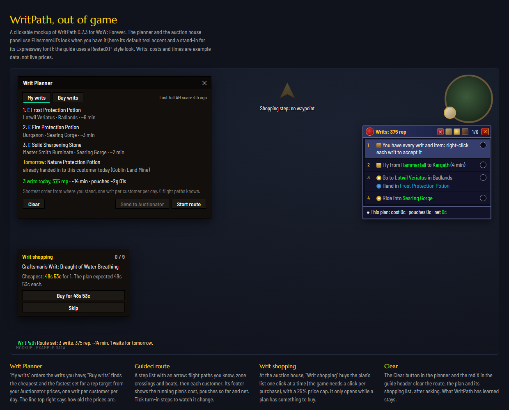

# WritPath

A World of Warcraft: Forever addon for Craftsman's Writs (Durotar Supply and Logistics / merchant reputation).

- **Buy writs:** set a rep target and get the cheapest and the fastest set of writs to reach it, priced live from
  your Auctionator scan, never two writs for the same customer in one day.
- **My writs:** the writs you already have, in the shortest hand-in order.
- **Guided route:** a RestedXP-style step list with an arrow, flight paths, zone crossings and boats.
- **Buying help:** "Send to Auctionator" makes a shopping list; at the auction house a "Writ shopping" panel buys
  the list one click at a time, with a price cap.
- **Money:** what each writ cost and what its coin pouch paid, per plan.
- **Learns as you play:** customer spots at turn-in, roads you ride, boats you take, flight times and which
  flight paths you know.

## Screenshots

Mockups with example data (open [mockups/writpath-mockup.html](mockups/writpath-mockup.html) in a browser to click
through it; add `#buy` to the address to start on the Buy writs plan).

## Install

1. On GitHub, click **Code > Download ZIP** and unzip it.
2. The folder inside is called `WritPath-main`: **rename it to `WritPath`** (WoW only loads an addon whose folder
   matches its `.toc` name).
3. Put it in `World of Warcraft/_forever_/Interface/AddOns/`, so you have `AddOns/WritPath/WritPath.toc`.
   (The `mockups` folder is only for this page; the game ignores it.)

Everything WritPath needs is in this folder. Optional addons it uses when you have them:

- **Auctionator**: needed for prices, so for "Buy writs" and the auction house buying panel. Do a full scan in
  Auctionator first. "My writs" (ordering writs you already have) works without it.
- **EllesmereUI**: WritPath's windows take its look; otherwise they use a plain dark style.

First time: open any flight master's map once on each continent, so WritPath learns which flight paths you know.
Roads, boats and flight times you use are learned as you travel.

## Use

Click the minimap button (right-click for the planner), or the map / coin icons on the guide window.
Slash commands: `/writs plan`, `/writs buy`, `/writs money`, `/writs clear`, `/writs travel` (what WritPath knows
about flight paths, roads and ships).

## License

CC BY-NC-SA 4.0. Includes pathing data adapted from RestedXP (CC BY-NC-SA 4.0). See [CREDITS.md](CREDITS.md)
and [LICENSE](LICENSE).
