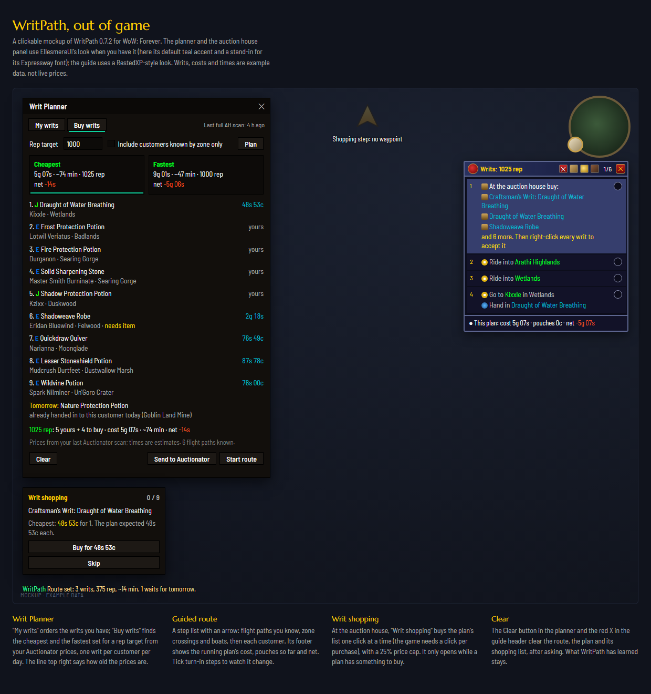

# WritPath

A World of Warcraft: Forever addon for Craftsman's Writs (Durotar Supply and Logistics / merchant reputation).

- **Plan:** set a rep target and get the cheapest and the fastest set of writs to reach it, starting from the
  writs you have and priced from WritPath's own auction house scan (or Auctionator's), never two writs for the
  same customer in one day. With no target, it plans just the writs you have, in the shortest hand-in order.
- **Guided route:** a RestedXP-style step list with an arrow, flight paths, zone crossings and boats.
- **Buying help:** "Send to Auctionator" makes a shopping list; at the auction house a "Writ shopping" panel buys
  the list one click at a time, with a price cap.
- **Money:** what each writ and its item cost and what its coin pouch paid, per plan.
- **Learns as you play:** customer spots at turn-in, roads you ride, boats you take, flight times and which
  flight paths you know.

## Screenshots

Mockups with example data (open [mockups/writpath-mockup.html](mockups/writpath-mockup.html) in a browser to click
through it; add `#buy` to the address to start on the Buy writs plan).

## Install

1. On GitHub, click **Code > Download ZIP** and unzip it.
2. The folder inside is called `WritPath-main`: **rename it to `WritPath`** (WoW only loads an addon whose folder
   matches its `.toc` name).
3. Put it in `World of Warcraft/_forever_/Interface/AddOns/`, so you have `AddOns/WritPath/WritPath.toc`.
   (The `mockups` folder is only for this page; the game ignores it.)

Everything WritPath needs is in this folder. Optional addons it uses when you have them:

- **Auctionator**: not needed (WritPath scans writ prices itself). If you have it, its prices are used when its
  scan is newer, and "Send to Auctionator" makes a shopping list there.
- **EllesmereUI**: WritPath's windows take its look; otherwise they use a plain dark style.

First time: open any flight master's map once on each continent, so WritPath learns which flight paths you know.
Roads, boats and flight times you use are learned as you travel.

### Staying up to date

1. Once: open `Interface\AddOns\WritPath	ools` and double-click **Setup Updater.bat**. It puts an
   **Update WritPath** shortcut on your desktop and checks for a new version each time you log in to Windows.
   No administrator rights needed; your settings and learned data are never touched.
2. In game, WritPath tells you when a newer version is out (it hears it from friends, guild or group members who
   already have it): double-click **Update WritPath**, then `/reload` (restart the game if new files were added).

To remove the updater: delete the two shortcuts (desktop, and "WritPath updater" in your Startup folder) and
`%LOCALAPPDATA%\WritPath`.

## How to use

### Before you start

1. **Scan writ prices at the auction house**: press **Scan** in the **WritPath prices** panel above the auction
   house window. It runs a detailed scan (every listing, stack sizes too) when the game allows one, once every 15
   minutes, and otherwise a quick summary scan (lowest price per item) with no wait. The panel shows how old the
   prices are and which kind of scan they came from. If you also use Auctionator, the newer prices are used.
2. **Open a flight master's map once on each continent.** That's how WritPath learns which flight paths you know.
   Until then routes can't use flights (`/writs travel` shows what it knows).
3. Find the **minimap button** (a note icon). Left-click shows or hides the guide window; right-click opens the
   planner. The guide window's header has the same buttons: map icon = Plan, bag icon = money report,
   red X = Clear.

### The one rule: one writ per customer per day

Each customer takes one writ a day. Writs that go to the same customer count as one, so WritPath never plans
two for the same customer on the same day; extra writs are listed as "Tomorrow" and kept for another day.

### Plan

Open the planner (map icon). There is one **Plan** button:

- **Leave the rep target empty** for just the writs you have: every writ in your bags or quest log in the fastest
  hand-in order from where you stand, with the customer, the zone and the travel time. Click **Start route**.
- **Type a rep target** (for example 1000) to reach it, starting from the writs you have:

1. Type a **Rep target** and press **Plan**.
2. Two plans appear:
   - **Cheapest**: the least gold that reaches the target.
   - **Fastest**: the quickest trip to the target. It starts from the customers next to your flight paths (fly in,
     hand in, fly out), adds the quickest other writs, and doesn't overpay for a minute or two: of the plans within
     about 10% of the quickest, it takes the cheapest.
   Each card shows the cost, the time, the rep and the net gold (coin pouches minus what you spend).
   Your own writs whose items you have are always used; ones that still need an item compete on price.
3. Click a card to see its writs. "yours" means you already have it; a price means it has to be bought.
   Customers known only by their zone are included too: when you accept their writ, its map pin gives the exact
   spot before you travel.
4. If the target can't be reached today, the plan says how close you can get and why.
5. Click **Start route**. This sets the guide, starts tracking the plan's money, and makes the shopping list.
   (**Send to Auctionator** also makes a "WritPath" shopping list in Auctionator, if you'd rather buy there.)

### Buy: the Writ shopping list at the auction house

Open the auction house and the **Writ shopping** list opens beside it with everything the plan needs (it only opens
while a plan has something left to buy).

- Every writ and item has a row with what it costs on the auction house right now (looked up as soon as you open
  it), and the top line shows the total left to buy, what you've bought and the plan's estimate.
- **Buy** walks down the list, one click each. For potions and other stackable goods the game first gives a firm
  price; when it matches what the list showed, WritPath confirms it for you. A higher price asks first (**Confirm**).
  Click a row to buy that one next.
- The **x** on a row skips it, and its writ or item with it. Anything not on the auction house is skipped by itself.
  Either way the route is rebuilt at once without that writ, and the plan's cost, rep and time follow.
- More than 25% over the plan's price stops and asks first, and an item only sold as a whole stack bigger than you
  need says so.
- Purchases that go to your mailbox count as yours straight away.
- **When you close the auction house**, the route is rebuilt from what you actually bought.

Then right-click each writ in your bags: WritPath accepts it for you (`/writs accept` turns that off).

### Follow the guide

The guide window shows the next steps, and an arrow on screen points to the current one with the distance.
Scroll over the steps with the mouse wheel to see the rest of the route (or the finished steps); it jumps back to
the current step when that one is done.

- **Fly** steps finish when you take the flight.
- **Road crossings and docks** finish once you're within 200 yards. If you take another road and reach a later
  one first, the guide catches up.
- **Hearthstone / teleport** steps: routes use your Hearthstone (to where it's bound), a shaman's Astral Recall, a
  mage's city teleports (with Runes of Teleportation) and a druid's Teleport: Moonglade on the legs where they save
  the most time, as their cooldowns allow. WritPath learns your hearth's spot when you set it at an innkeeper or
  land from it; until then it uses your bind town's flight point.
- **Customer** steps finish only when you hand the writ in. Talk to the customer and WritPath hands it in for you
  (`/writs accept` turns that off).
- **Learn the flight path** steps appear for any zone the route takes you to where you don't have its flight
  path, on your way in or right after the hand-in. They finish when you learn it ("New flight path discovered!") or open that flight master's map
  (`/writs next` skips one you don't want). As soon as you enter a zone whose flight path
  you don't have, the guide says so at the top (with the flight master's spot), and learning one re-plans the
  rest of the trip.
- **Learn the flight path at X, then fly to Y**: routes also use your faction's flight paths you haven't learned
  yet. Riding up to one learns it, and you can take off from it straight away to any you have.
- The rest of the trip is worked out again from where you stand after each hand-in, whenever you gain a flight
  path, and when you enter a new zone (chat only says so when the way ahead changes).
- If a step gets stuck, `/writs next` skips it and `/writs back` undoes that.

The footer under the guide shows the running plan's money: **cost** (what you actually paid once you've bought,
plus anything still to buy; the planned cost is shown next to it), **pouches** from turn-ins so far, and **net**.
The bag icon prints every turn-in's cost and pouch in chat.

Every route is timed: when its last writ is in, chat compares your real travel time (and buying time) with
the planner's estimate. After three finished runs, the planner's minutes are scaled to your pace.

**Clear** (the button in the planner, or the red X in the guide header) clears the route, the plan and its shopping
list after asking. What WritPath has learned stays.

### What WritPath learns as you play

- **Customer spots**: the map pin when you accept a writ, and your exact spot when you hand one in. Customers
  that were "zone only" become exact.
- **Roads, boats and zeppelins** you ride, and **flight times** of flights you take.
- **Flight paths you know**, each time you open a flight master's map.

It starts from what ships with it (customer spots from community sources and QuestieDB, RestedXP's roads, boats
and flight points, and trips other WritPath players recorded), and what you learn always wins.

### Slash commands

| Command | What it does |
|---|---|
| `/writs` | Show or hide the guide window |
| `/writs plan` | Open the planner |
| `/writs mine` | Planner with no target: just the writs you have |
| `/writs buy` | Planner with your last rep target |
| `/writs runs` | Your last runs: the planner's time estimate against your real travel and buying time |
| `/writs money` | Every turn-in's cost (writ + item) and pouch, in chat |
| `/writs accept` | Turn off (or back on) accepting writs for you when you open them, and handing them in when you talk to their customer |
| `/writs clear` | Clear the route, the plan and its shopping list (no confirm) |
| `/writs travel` | Which flight paths are known and placed, and how many roads and ships WritPath knows |
| `/writs leg` | Why the way to the next customer looks the way it does (times, route, nearest flight points and docks); also saved for a `/reload` |
| `/writs why` | Why some writs aren't in plans (no price, customer unknown, ...) |
| `/writs scan` | Read the map pins of the writs you've accepted |
| `/writs next` / `/writs back` | Skip the current guide step / undo the last skip |
| `/writs reset` | Start the guide's steps over |

### Troubleshooting

- **The route walks everywhere**: run `/writs travel`. If flight paths are missing or "not placed", open a flight
  master's map and plan again.
- **"No AH price"** or writs missing from plans: press **Scan** in the WritPath prices panel at the auction house; `/writs why` gives the reasons.
- **The Writ shopping panel doesn't open**: it only opens while a running plan still has something to buy.
- **A customer's spot is wrong**: accept the writ (its map pin corrects it) or hand it in (your spot is saved).

## License

MIT (see [LICENSE](LICENSE)). Data sources are credited in [CREDITS.md](CREDITS.md).
